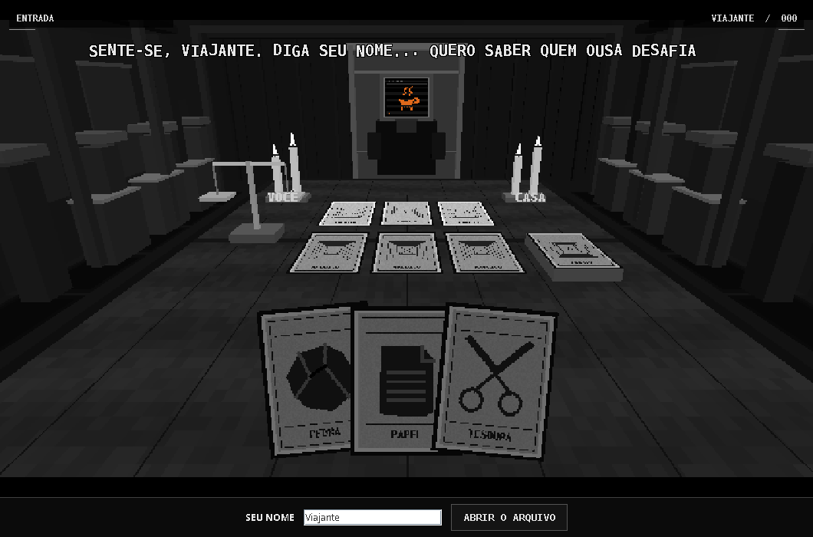
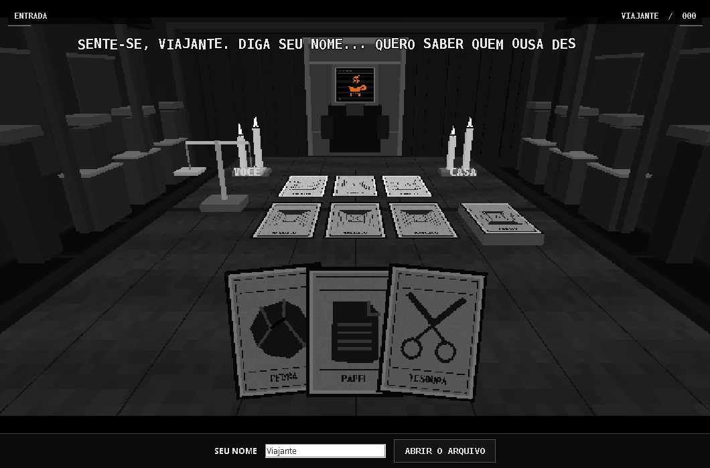

# Vs Deus Java

Um protótipo de jogo com cenário 3D, desenvolvido em Java, como atividade prática das aulas de P.A. O jogo é dividido em **3 fases**, com sistema de pontuação, perguntas e interação com o cenário.

Esta versão foi feita a partir do `JogoCartas.java` original, que tinha aproximadamente 1.124 linhas. Durante a refatoração, tentei simplificar e organizar o código sem mudar a identidade visual e o funcionamento principal do jogo.

## Prévia do projeto

Abaixo estão algumas capturas do cenário. Elas também servem para visualizar o resultado da refatoração.

| Versão original | Versão refatorada |
| --- | --- |
|  |  |

## Como os gráficos 3D foram feitos?

Essa é provavelmente a parte mais diferente do projeto.

Os cenários e alguns elementos gráficos foram criados por mim no **Blender**. Porém, em vez de utilizar uma biblioteca 3D pronta para renderizar tudo dentro do Java, quis experimentar uma abordagem diferente: transformar os modelos e animações em instruções que o meu próprio renderizador conseguisse interpretar.

Na prática, o processo foi mais ou menos assim:

1. Criei os elementos visuais e as animações no Blender.
2. Utilizei um algoritmo desenvolvido com auxílio de IA para ajudar a converter os dados dos modelos em instruções de geometria.
3. Essas instruções passaram a ser utilizadas pelo `Render3D.java`.
4. O renderizador transforma os pontos tridimensionais em posições na tela e desenha os objetos utilizando `BufferedImage`.

As animações seguem uma ideia parecida. Criei os keyframes e os movimentos, mas utilizei IA como auxílio para adaptar e portar essas informações para o sistema de renderização por software.

Não foi um processo totalmente automático. Os modelos, o conteúdo visual e as animações foram feitos por mim; a parte em que utilizei mais auxílio foi na conversão e adaptação técnica dos dados.

## Organização dos arquivos

Separei o projeto em seis arquivos para facilitar a leitura e deixar cada parte responsável por uma coisa.

| Arquivo | O que faz |
| --- | --- |
| `JogoCartas.java` | É onde fica o jogo em si: as três fases, pontuação, respostas, janela (`JFrame`) e botões. |
| `Mesa3D.java` | Organiza o cenário, posicionando mesas, cartas, corredor, velas e o adversário. |
| `Texturas.java` | Cria as imagens das cartas diretamente na memória, sem precisar carregar arquivos de imagem externos. |
| `Animacao.java` | Controla os movimentos da câmera, das cartas, da balança e da porta. |
| `Fala.java` | Faz o texto aparecer aos poucos, criando aquele efeito de diálogo. |
| `Render3D.java` | É a parte responsável por desenhar o cenário em 3D usando cálculos e imagens, sem depender de uma engine gráfica pronta. |

### Minha participação no desenvolvimento

Nem todas as partes foram feitas exatamente da mesma maneira. Algumas eu desenvolvi por conta própria, outras foram experimentos e em algumas precisei de ajuda para conseguir implementar o que tinha planejado.

**JogoCartas.java — desenvolvido por mim**

Foi a parte que fiz diretamente, do começo ao fim. Trabalhei principalmente nas regras das três fases, nas perguntas, no sistema de pontuação e na interface. Os métodos que mais representam essa parte são `jogar()`, `responder()`, `avancarQuiz()` e `atualizarTela()`.

**Mesa3D.java — experimentação com modelos**

Aqui tentei importar e organizar elementos tridimensionais por conta própria. Os métodos `sala()`, `mesa()`, `adversario()` e `vela()` ajudam a montar o cenário e posicionar seus objetos.

**Texturas.java — tentativa e erro**

As cartas são desenhadas proceduralmente, ou seja, as imagens são criadas pelo próprio código em vez de serem carregadas de arquivos externos. Fiz essas texturas de maneira simples, principalmente experimentando com formas, cores e desenhos.

**Animacao.java — keyframes feitos por mim**

Criei os movimentos e os keyframes das animações. Para adaptar essas informações ao renderizador por software, utilizei auxílio de IA. As constantes `DURACAO`, `CAMINHADA` e `CAMINHO` ajudam a controlar os movimentos.

**Render3D.java — renderizador próprio, com auxílio pontual**

Implementei o renderizador utilizando `BufferedImage` e cálculos geométricos. Foi uma das partes mais trabalhosas, principalmente por envolver perspectiva, polígonos e profundidade.

Também utilizei um algoritmo desenvolvido com auxílio de IA para converter os dados dos elementos que criei no Blender em instruções que o renderizador pudesse utilizar. Então, apesar de ter desenvolvido essa parte, reconheço que tive auxílio técnico nessa conversão.

## Entendendo o funcionamento do código

Não é necessário entender todas as contas matemáticas do renderizador para acompanhar o funcionamento geral do jogo.

A estrutura principal é relativamente simples:

1. `JogoCartas` controla a janela e mostra os elementos de cada fase.
2. `iniciar()` prepara uma nova partida, zerando a pontuação.
3. `jogar()` resolve o duelo utilizando números aleatórios.
4. `responder()` confere a alternativa escolhida e atualiza os pontos.
5. `avancarQuiz()` decide se o jogo continua na pergunta seguinte ou passa para outra fase.
6. `Mesa3D` organiza os objetos do cenário, enquanto `Texturas` cria as imagens utilizadas.
7. `Render3D` transforma as coordenadas dos objetos em pixels na tela e utiliza informações de profundidade para desenhar os elementos na ordem correta.

Uma das contas utilizadas na projeção de perspectiva é:

`x_tela = x * foco / z`

Ela ajuda a transformar uma posição tridimensional em uma posição horizontal na imagem. A ideia é que objetos mais distantes apareçam menores, dando a sensação de profundidade.

O renderizador também utiliza um sistema de profundidade (Z-buffer), que ajuda a determinar qual objeto deve aparecer na frente quando existem partes sobrepostas.

## O que mudou na refatoração?

O objetivo não foi simplesmente diminuir a quantidade de linhas. Quis deixar o projeto mais organizado e facilitar a manutenção, sem descaracterizar o resultado visual.

Algumas mudanças que fiz:

- Comparei capturas visuais do original e da versão refatorada, utilizando a mesma resolução. O cenário e as cartas permaneceram praticamente idênticos.
- Executei um teste automatizado passando pelas três fases até chegar ao resultado final.
- Simplifiquei a interpolação da caminhada da câmera. Antes era utilizada interpolação Hermite; substituí por uma interpolação suave mais simples, mantendo os pontos do percurso. A velocidade da transição pode variar um pouco em relação à original.
- Simplifiquei a atualização da balança, utilizando um comportamento de mola. Também removi algumas estruturas de repetição desnecessárias e deixei a atualização condicionada ao estado da animação.

As imagens `capturas/original.png` e `capturas/refatorado.png` foram mantidas no projeto justamente para facilitar essa comparação.

## Como abrir no Eclipse

O projeto foi preparado para ser aberto diretamente no Eclipse, que é a IDE utilizada nas aulas.

1. Descompacte o ZIP.
2. Abra o Eclipse.
3. Acesse **File > Import > General > Existing Projects into Workspace**.
4. Selecione a pasta `JogoCartas-fiel`.
5. Conclua a importação.
6. Abra `src/JogoCartas.java`.
7. Clique com o botão direito e escolha **Run As > Java Application**.

É necessário ter um JDK compatível com o código (Java 11 ou superior). O projeto não utiliza bibliotecas externas.

## Compilar pelo terminal

Também é possível compilar sem abrir o Eclipse:

```bash
mkdir -p bin
javac -encoding UTF-8 -d bin src/*.java
java -cp bin JogoCartas
```

## Considerações finais

Esse projeto acabou indo um pouco além do que eu tinha aprendido inicialmente nas aulas. Comecei trabalhando na lógica do jogo e, durante o desenvolvimento, fui experimentando outras coisas para conseguir chegar ao resultado que queria.

A parte de interface e das regras foi desenvolvida diretamente por mim. Já a renderização 3D e a conversão dos dados do Blender exigiram bastante pesquisa, tentativa e erro, além de auxílio pontual de IA.

Ainda existem partes que estou aprendendo a entender melhor, principalmente os cálculos do renderizador. Mesmo assim, procurei não deixar o código como uma caixa-preta: tentei entender a aplicação de cada parte e adaptar o funcionamento ao que eu queria construir.

A ideia da refatoração foi justamente essa: deixar o projeto mais organizado, facilitar a leitura e conseguir explicar melhor como ele funciona.
